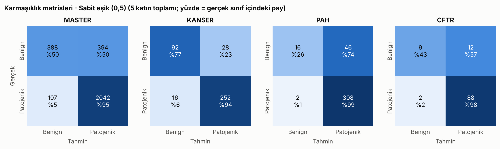
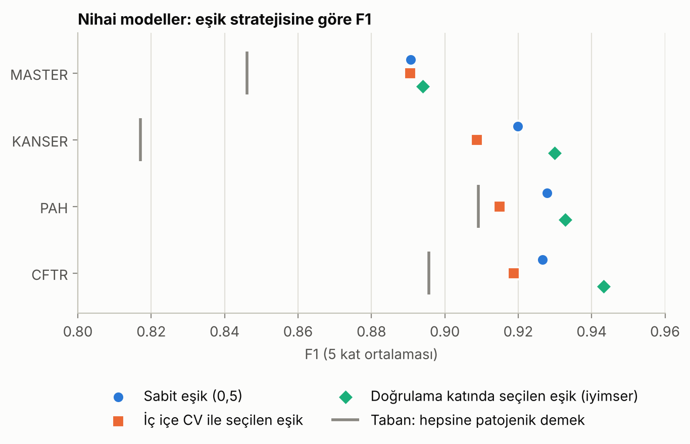
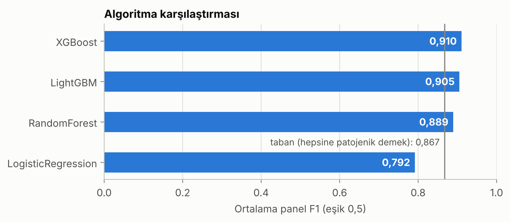

# AEGIS: Missense Varyant Patojenite Sınıflandırması

Bir genetik varyantın hastalık yapıcı (patojenik) mi yoksa zararsız (benign) mı
olduğunu tahmin eden, panel bazlı bir makine öğrenmesi çalışması. TEKNOFEST 2026
Sağlıkta Yapay Zekâ Yarışması (Üniversite ve Üzeri Seviyesi) için iki kişilik
bir ekip olarak geliştirildi. Proje PSR aşamasını geçti ve Proje Detay Raporu
(PDR) aşamasında hakem değerlendirmesinden 100 üzerinden 87 puan aldı.

Bu depo, yarışma sırasında yazılan deney kodunun düzenlenmiş hâlidir: veri
kontrolünden nihai modele kadar her adım tek komutla yeniden çalıştırılabilir.

## Özet

| | |
|---|---|
| Problem | İkili sınıflandırma (patojenik / benign), dört hastalık paneli için ayrı model |
| Veri | 3.802 satır, 351 anonim özellik, %55 eksik hücre |
| Model | Panel başına ayarlanmış XGBoost |
| Doğrulama | `Variant_ID` gruplu, katmanlı 5 katlı çapraz doğrulama |
| Ortalama panel F1 | **0,916** (eşik 0,5). Her varyanta "patojenik" diyen taban: 0,867 |
| ROC-AUC / PR-AUC | 0,853 / 0,943 |
| Özgüllük (specificity) | 0,49. Model benign varyantların yarısını patojenik sayıyor |

Son satır önemli: sınıflar dengesiz olduğu için F1 tek başına iyimser bir tablo
çizer. Ayrıntısı [Sonuçlar](#sonuçlar) ve [Bilinen sınırlamalar](#bilinen-sınırlamalar)
bölümlerinde.

## Veri

Yarışmanın sağladığı anonimleştirilmiş veri dört panelden oluşur. Veri bu depoda
yer almaz; nasıl yerleştirileceği [`data/README.md`](data/README.md) dosyasında.

| Panel | Satır | Patojenik | Benign | Eksik hücre |
|---|---:|---:|---:|---:|
| MASTER | 2.931 | %73,3 | %26,7 | %55,3 |
| KANSER | 388 | %69,1 | %30,9 | %57,5 |
| PAH | 372 | %83,3 | %16,7 | %54,6 |
| CFTR | 111 | %81,1 | %18,9 | %30,5 |

Özellikler dört ailede gelir: `AL_` (popülasyon / alel istatistikleri, 334 sütun),
`EK_` (in-silico tahmin skorları, 9), `CAT_` (kategorik genomik bağlam, 6) ve
`AA_` (referans ve değişen amino asit, 2).

3.802 satırda 3.224 benzersiz varyant vardır; 578 satır başka bir panelde de
geçen bir varyanta aittir. Aynı varyantın eğitim ve doğrulama tarafına birlikte
düşmesi sonucu şişireceği için bütün deneyler `Variant_ID` ile gruplanmış
çapraz doğrulama kullanır ve her katta çakışma olmadığı kodla kontrol edilir.

## Yöntem

Çalışma on iki adımda ilerledi. Her adım `python -m aegis <adım>` ile çalışır;
tablodaki F1, dört panelin ortalamasıdır (eşik 0,5, aksi belirtilmedikçe).

| # | Adım | Ne yapıyor | Sonuç |
|---|---|---|---|
| 01 | `data-check` | Boyut, sınıf dengesi, eksiklik, paneller arası etiket tutarlılığı | Etiket çelişkisi yok |
| 02 | `baseline` | LightGBM, ham sayısal sütunlar | 0,902 |
| 03 | `threshold` | Karar eşiğinin etkisi (eşik doğrulama katında seçilir) | 0,915 (iyimser) |
| 04 | `features` | LightGBM, özellik mühendisliği | 0,905 |
| 05 | `ablation` | Özellik ailelerini tek tek çıkarma / tek başına kullanma | En çok `EK_` çıkınca düşüyor: 0,894 |
| 06 | `nested-threshold` | Eşiği yalnızca eğitim verisinden seçme (iç içe CV) | 0,903 |
| 07 | `model-selection` | LightGBM, XGBoost, Random Forest, Lojistik Regresyon | XGBoost 0,910 |
| 08 | `xgb-threshold` | XGBoost için eşik çalışması | 0,923 (iyimser) |
| 09 | `xgb-search` | Panel başına rastgele hiperparametre araması (12 deneme, 3 kat) | Panel başına bir yapılandırma |
| 10 | `xgb-tuned` | Ayarlanmış XGBoost, kanıt skorları olmadan | 0,909 |
| 11 | `final` | Ayarlanmış XGBoost + ACMG benzeri kanıt skorları | **0,916** |
| 12 | `report` | Şekiller ve özet rapor | `outputs/` |

**Özellik mühendisliği** ([`aegis/features.py`](aegis/features.py)). Sürekli
popülasyon değerleri `-log10` ölçeğine alınır; in-silico skorlar arasındaki
uyum (ortalama, en yüksek, eşik üstü skor sayısı) özetlenir; amino asit
değişiminin hidrofobiklik ve hacim farkı hesaplanır; kategoriler en sık
değerleri üzerinden kodlanır; satır başına eksiklik oranları eklenir. Eksik
değerler doldurulmaz: ağaç tabanlı modeller bunları doğrudan işler ve genomik
veride "bilgi yok" durumunun kendisi de bilgi taşır.

**Kanıt skorları** ([`aegis/evidence.py`](aegis/evidence.py)). ACMG/AMP
kılavuzundaki kanıt türlerinden (popülasyonda nadirlik, in-silico destek)
esinlenen özet skorlar ve her panele özgü birkaç birleşik skor. Sütunlar anonim
olduğu için bunlar kılavuzun uygulaması değil, sezgisel yaklaşımlardır.

## Sonuçlar

### Nihai modeller

| Panel | F1 | Precision | Recall | Özgüllük | MCC | PR-AUC | ROC-AUC | Taban F1 |
|---|---:|---:|---:|---:|---:|---:|---:|---:|
| MASTER | 0,891 | 0,838 | 0,950 | 0,496 | 0,527 | 0,924 | 0,846 | 0,846 |
| KANSER | 0,920 | 0,901 | 0,940 | 0,767 | 0,729 | 0,932 | 0,898 | 0,817 |
| PAH | 0,928 | 0,871 | 0,994 | 0,256 | 0,418 | 0,937 | 0,771 | 0,909 |
| CFTR | 0,927 | 0,884 | 0,978 | 0,430 | 0,496 | 0,977 | 0,896 | 0,896 |
| **Ortalama** | **0,916** | 0,873 | 0,966 | 0,487 | 0,543 | 0,943 | 0,853 | 0,867 |

Değerler 5 katın ortalamasıdır, karar eşiği 0,5. "Taban F1", her varyanta
patojenik diyen bir modelin F1 değeridir.



Nasıl okunmalı:

- Model patojenik varyantları neredeyse hiç kaçırmıyor (recall 0,94-0,99), ama
  bunu benign varyantların önemli bir kısmını da patojenik sayarak yapıyor.
  Özgüllük KANSER panelinde 0,77 iken PAH panelinde 0,26.
- PAH ve CFTR'de model, taban F1'in yalnızca 0,02-0,03 üzerinde. Bu panellerde
  benign örnek çok az (62 ve 21), yani bir doğrulama katına yaklaşık 12 ve 4
  benign varyant düşüyor; sonuçlar gürültülü.
- Modelin sıralama gücü en net KANSER panelinde görülüyor (ROC-AUC 0,90, MCC 0,73).

### Karar eşiği: raporlanan değer neden daha yüksek?

Yarışma sırasında ürettiğimiz sonuç tablolarında ortalama F1 0,926'dır. O değer,
karar eşiği her doğrulama katında o katın kendi etiketlerine bakılarak
seçildiğinde elde edilir; yani ölçümün yapıldığı veri eşik seçiminde de
kullanılmıştır. Bu depo üç stratejiyi yan yana raporlar:

| Eşik stratejisi | Ortalama F1 | Özgüllük | MCC |
|---|---:|---:|---:|
| Sabit 0,5 | 0,916 | 0,487 | 0,543 |
| İç içe CV: eşik yalnızca eğitim verisinden seçilir | 0,908 | 0,390 | 0,461 |
| Doğrulama katında seçilen eşik (iyimser üst sınır) | 0,925 | 0,521 | 0,594 |



Eşik sızıntısız seçildiğinde sabit 0,5'ten daha iyi değil, hatta biraz daha kötü.
Küçük panellerde seçilen eşik kattan kata 0,01 ile 0,75 arasında oynuyor; yani
"panele özgü eşik" bu veri boyutunda güvenilir biçimde öğrenilemiyor. Bu yüzden
depodaki ana sonuç sabit 0,5 eşiğiyle verilir.

### Algoritma karşılaştırması



XGBoost ile LightGBM arasındaki fark (0,005), üç küçük panelde 0,02-0,03 olan
kat-arası standart sapmanın altındadır; en büyük panel olan MASTER'da ise
LightGBM öndedir (0,891'e 0,888). İki model pratikte denktir.

### Hangi adım ne kattı?

| Yapılandırma | Ortalama F1 (eşik 0,5) |
|---|---:|
| Taban: hepsine patojenik demek | 0,867 |
| LightGBM, ham sütunlar | 0,902 |
| LightGBM, özellik mühendisliği | 0,905 |
| XGBoost, özellik mühendisliği | 0,910 |
| XGBoost, hiperparametre araması | 0,909 |
| XGBoost, arama + kanıt skorları (nihai) | 0,916 |

Kazancın büyük kısmı ham sütunlarla eğitilen ilk modelden geliyor. Sonraki
adımların her biri en fazla 0,008 ekliyor; bu farklar küçük panellerdeki
kat-arası oynaklıktan (0,02-0,03) küçük olduğu için tek tek anlamlı oldukları
söylenemez.

Diğer şekiller: [eşik eğrileri](outputs/figures/aegis_v2_threshold_curves.png),
[precision-recall eğrileri](outputs/figures/aegis_v2_pr_curves.png),
[özellik önemleri](outputs/figures/aegis_v2_feature_importance.png). Bütün
tablolar `outputs/tables/` altında, özet rapor
[`outputs/reports/aegis_v2_report.md`](outputs/reports/aegis_v2_report.md) dosyasında.

## Bilinen sınırlamalar

- **Bağımsız test seti yok.** Model seçimi, hiperparametre araması ve özellik
  kararları aynı çapraz doğrulama üzerinde verildi; raporlanan değerler bu yüzden
  bir miktar iyimserdir.
- **Düşük özgüllük.** Yukarıda anlatıldığı gibi model patojenik sınıfa yatkın.
  Sınıf ağırlıkları ya da F1 yerine MCC / dengeli doğruluk hedefleyen bir eşik
  denenmedi.
- **Kanıt skorları sezgisel.** `AL_` ailesi frekans, sayım ve 0/1 bayrak
  sütunlarını bir arada içeriyor ve hepsine aynı eşikler uygulanıyor. Örneğin
  `ACMG_BA1_population_common_any`, satırların %98-100'ünde "bu varyant için
  popülasyon verisi var mı" bayrağıyla aynı değeri alıyor.
- **Dört özellik hiç bilgi taşımıyor.** `EK_7_high_20` ve `EK_7_high_30`
  (`EK_7` bu veride 10'u geçmiyor), `AA_is_synonymous` (veride eş anlamlı
  değişim yok) ve `AA_blosum_simple` (tabloda yalnızca köşegen var) her satırda
  aynı değeri alıyor. Nihai modellerde sabit sütunlar kat içinde atıldığı için
  sonucu etkilemiyor.
- **Bazı istatistikler bölmeden önce hesaplanıyor.** Kanıt skorlarındaki medyanlar
  ve en sık kategoriler panelin tamamından alınıyor. Etiket kullanılmıyor, ama
  katı anlamda doğrulama katından bilgi taşınıyor.
- **Lojistik regresyon ölçeklenmeden eğitildi** ve yakınsamıyor. Ölçekleme
  eklendiğinde F1 0,79'dan 0,85'e çıkıyor; sıralama değişmiyor.
- **Hiperparametre araması dar.** 12 deneme ve 3 katla en iyi adaylar birbirinden
  ayırt edilemiyor; XGBoost sürümü değiştiğinde kazanan yapılandırma da
  değişebiliyor. Nihai parametreler `aegis/config.py` içinde sabitlenmiştir.

## Çalıştırma

Python 3.11 veya üzeri gerekir.

Depoyu klonladıktan sonra, depo klasöründe:

```bash
python -m venv .venv
source .venv/bin/activate          # Windows: .venv\Scripts\activate
pip install -r requirements.txt
```

Dört veri dosyasını `data/` klasörüne koyduktan sonra:

```bash
python -m aegis final report       # nihai modeller ve şekiller (yaklaşık 3 dakika)
python -m aegis all                # on iki adımın tamamı (yaklaşık 20 dakika)
python -m aegis --help             # adımların listesi
```

Testler yarışma verisine ihtiyaç duymaz, küçük bir sentetik veriyle çalışır:

```bash
python -m unittest discover -s tests
```

### Tekrarlanabilirlik

Bütün rastgelelik `random_state=42` ile sabittir; aynı ortamda sonuçlar her
çalıştırmada aynıdır. Farklı XGBoost sürümleri arasında panel F1 değerleri
üçüncü ondalıkta değişir (ör. ortalama 0,925 ile 0,926). Bu sayfadaki değerler
Python 3.13, pandas 3.0.5, scikit-learn 1.9.1, XGBoost 3.0.2 ve LightGBM 4.6.0
ile üretildi. pandas 3 zorunludur (bkz. `requirements.txt`).

## Proje yapısı

```
aegis/
├── config.py          yollar, paneller, tohum değeri, hiperparametreler
├── data.py            veri okuma ve doğrulama
├── features.py        özellik mühendisliği
├── evidence.py        ACMG benzeri kanıt skorları
├── models.py          model tanımları
├── evaluation.py      çapraz doğrulama, metrikler, eşik seçimi
├── plots.py           şekiller
├── __main__.py        komut satırı arayüzü
└── experiments/       on iki adım, çalıştırıldıkları sırayla (e01 … e12)
tests/                 sentetik veriyle birim testleri
data/                  yarışma verisi (depoya dahil değil)
outputs/               tablolar, şekiller, özet rapor
```
